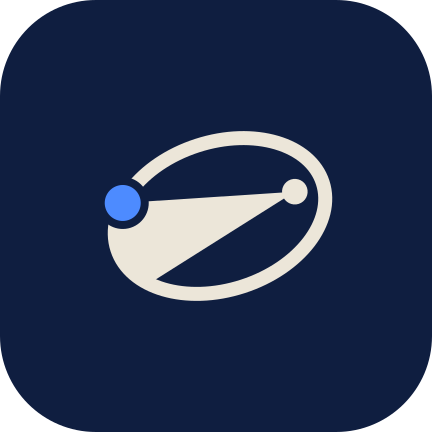

<div align="center">



# Kepler

**Read. Listen. Remember.**

*A private, open-source Android app designed to help you deeply read, listen to, and truly internalize books.*

[](LICENSE)
[-green.svg)](app)
[](https://kotlinlang.org)
[](https://developer.android.com/jetpack/compose)

</div>

---

## Overview

Most ebook readers simply display text. Audiobook players stream narration without sentence context. Note apps collect highlights that fade from memory.

**Kepler** is a native Android application built around a single premise: **books should be internalized, not just consumed.** It unites an EPUB reader, AI or on-device narration with sentence-level read-along, and an active recall study loop powered by the FSRS-6 spaced repetition algorithm and contextual LLMs.

Non-fiction is treated as a first-class citizen: the app builds a concept map, synthesizes chapter packs, tests your comprehension, and clips every AI prompt at your reading position so AI insights **never spoil content past where you are**.

---

## Core Pillars

```
┌────────────────────────────────────────────────────────────────────────┐
│                                 KEPLER                                 │
├───────────────────┬────────────────────────────┬───────────────────────┤
│     1. READ       │         2. LISTEN          │      3. REMEMBER      │
│  ───────────────  │  ────────────────────────  │  ───────────────────  │
│  • EPUB (Readium) │  • Fish Audio (S2.1 Pro)   │  • FSRS-6 Flashcards  │
│  • Literata type  │  • Offline System TTS      │  • The AI Fence       │
│  • Paper themes   │  • Synced Read-Along       │  • Chapter Packs      │
│  • FTS5 Search    │  • Media3 Playback Engine  │  • Selection AI       │
│  • AI Define      │  • Sleep Timer & Shake     │  • "Previously on..." │
└───────────────────┴────────────────────────────┴───────────────────────┘
```

### 1. Read
- **EPUB Reader:** Powered by Readium 3.4, with Readium CSS styling and decoration-based sentence and highlight marks.
- **Editorial Typography:** Bundled *Literata* for reading (plus serif, sans-serif and publisher fonts) and *Fraunces* / *Albert Sans* for the interface; page themes (Day, Paper, Sepia, Night, Black, Custom), margins, and line-height controls.
- **The Text Spine Coordinate System:** Every paragraph and sentence is mapped to deterministic sentence IDs, ensuring that bookmarks, highlights, audio sync, and study cards survive re-pagination and re-flows.
- **Full-Text In-Book Search:** Keyword and passage search via SQLite FTS5.
- **Notes Handling:** Footnote and endnote sections are detected at import and moved out of the linear reading and narration flow.
- **Define:** Select a word to get an LLM definition in the book's context (needs an OpenRouter key; not an offline dictionary).

### 2. Listen
- **High-Fidelity AI Narration:** Generates natural narration using Fish Audio (S2.1 Pro) with a voice you choose.
- **100% Offline System TTS:** Full support for on-device Android text-to-speech engines without requiring network connectivity or API keys.
- **Synchronized Read-Along:** Custom `ReadAlongPlayer` highlights sentences in real-time as the narration plays, offering seamless switching between reading and listening.
- **Professional Playback Controls:** Media3 ExoPlayer engine with speed adjustment (0.5×–3.5×), sleep timer with shake-to-extend, headset controls, and lock screen media notifications.
- **Background Audio Generation:** Generates voice tracks in the background via Android WorkManager with live progress, time-left estimates, and up-front cost estimates.

### 3. Remember
- **FSRS-6 Spaced Repetition:** Flashcard review engine implementing the Free Spaced Repetition Scheduler (FSRS-6).
- **The AI Fence:** Every LLM prompt is clipped to text up to your current reading position, so recaps, answers, and concept cards do not spoil what comes next.
- **Chapter Packs:** One cached request per chapter producing a gist, key ideas, events, concepts and their relations, takeaways, a check-in question, and card candidates.
- **Concept Map:** People, places, and ideas from the chapter packs drawn as a map of how they relate, limited to what you have read.
- **Selection AI:** Select any sentence or paragraph in the reader to instantly **Explain**, **Ask**, or generate targeted study cards.
- **"Previously on..." Recaps:** When returning to a book after 3 or more days away, Kepler streams a concise recap of preceding events or key concepts before you resume.
- **Daily Review:** Home shows cards due today with a time estimate and dots for the days you reviewed this week.
- **Open Exports:** Export highlights and notes as Markdown (Obsidian-friendly, with deep links back to each sentence) or W3C Web Annotation JSON. Flashcards are not exported yet.

---

## Home Dashboard & UX Design

Kepler adheres to the **Material 3 Expressive** design system with organic, tactile motion, comprehensive haptics, and adaptive color palettes:

- **Continue Card:** Displays your current book with a dynamic 3D-angled cover tilt, position progress bar, mode chip (Reading vs. Listening), and one-tap resume.
- **Now-Bar Mini Player:** Persistent audio controller docked above navigation tabs that morphs fluidly into the full-screen player.
- **3D Bookcase & Grid Views:** Switch between a modern, responsive cover grid with audio badges or a physical-style 3D rendered bookcase with leaning spines and shelf planks.
- **ColorOS / OxygenOS Optimization:** Integrated background execution guides for OEM battery savers (OPPO, OnePlus, realme) to safeguard background narration generation.

---

## Privacy & Offline First

Kepler is built with strict privacy and data ownership guarantees:

- **Zero Tracking:** No analytics, no telemetry, no tracking SDKs, and no ads.
- **Bring Your Own Keys (BYOK):**
  - **Fish Audio:** Required only for generated voice models.
  - **OpenRouter:** For AI study features (Ask, Recap, Concepts, Cards). Fully compatible with free `:free` models (e.g. `nvidia/nemotron-3-super-120b-a12b:free`).
- **Hardware-Backed Encryption:** API keys are encrypted at rest with AES-256-GCM using a non-exportable key held in the Android Keystore. App data is excluded from cloud backup and device transfer.
- **Offline Core:** The EPUB reader, search, FSRS flashcard scheduler, and system TTS work completely offline. Define, Ask, recaps, and chapter packs need OpenRouter; Fish narration needs Fish Audio.

---

## Architecture & Codebase

The project is structured into clear modular layers separating domain models, engines, and UI features:

```
Kepler/
├── app/                      # Application entry point, state-based back stack navigation, DI container
├── core/
│   ├── model/                # Pure Kotlin domain entities, repository interfaces, engines
│   ├── database/             # Room 3 entities, SQLite FTS5, DataStore, Keystore crypto
│   ├── designsystem/         # Material 3 Expressive tokens, Kp components, 3D BookScene
│   └── spine/                # Text spine segmentation, ordinal locator math
├── engine/
│   ├── epub/                 # Readium 3.4 integration, EPUB streaming & transform
│   ├── tts/                  # Fish Audio client, Android system TTS engine
│   ├── playback/             # Media3 ExoPlayer, MediaSession, ReadAlongPlayer coordinator
│   ├── ai/                   # OpenRouter streaming client, model prober, AI fence, prompts
│   └── srs/                  # FSRS-6 spaced repetition algorithm implementation
└── feature/
    ├── library/              # Home dashboard, Bookcase/Grid library, Hub, Settings
    ├── reader/               # Readium reading view, typography sheets, selection actions
    ├── player/               # Fullscreen player, speed dialogs, chapter list
    └── study/                # Learn screen, flashcard review loop, notebook, search
```

---

## Building from Source

Kepler can be built completely from the command line without Android Studio.

### Prerequisites

- **JDK 21**
- **Android SDK** with platform `android-37` and build-tools `37.0.0`
- `ANDROID_HOME` pointing to your Android SDK installation directory

### Build & Install

```bash
# Set environment variables
export JAVA_HOME=/path/to/jdk-21
export ANDROID_HOME=$HOME/Library/Android/sdk   # macOS default path

# Build the debug APK
./gradlew :app:assembleDebug

# Install on a connected Android device or emulator
./gradlew :app:installDebug
```

The resulting APK will be located at:
```
app/build/outputs/apk/debug/app-debug.apk
```

### Running Tests

Run the full test suite across all modules:

```bash
./gradlew testDebugUnitTest
```

Or target specific core and engine modules:

```bash
./gradlew :core:model:test \
          :core:spine:test \
          :core:database:testDebugUnitTest \
          :engine:epub:testDebugUnitTest \
          :engine:playback:testDebugUnitTest \
          :engine:tts:testDebugUnitTest \
          :engine:ai:test \
          :engine:srs:test \
          :feature:library:testDebugUnitTest \
          :feature:study:testDebugUnitTest
```


---

## Contributing

Contributions, bug reports, and pull requests are warmly welcomed! Please ensure all code and dependencies maintain strict **GPL-3.0 compatibility** (no AGPL code, no proprietary SDKs, and no Google Play Services).

Third-party dependencies and their respective licenses are cataloged in [NOTICE.md](NOTICE.md).

---

## License

Kepler is free software: you can redistribute it and/or modify it under the terms of the **GNU General Public License version 3** as published by the Free Software Foundation. See the [LICENSE](LICENSE) file for complete details.
